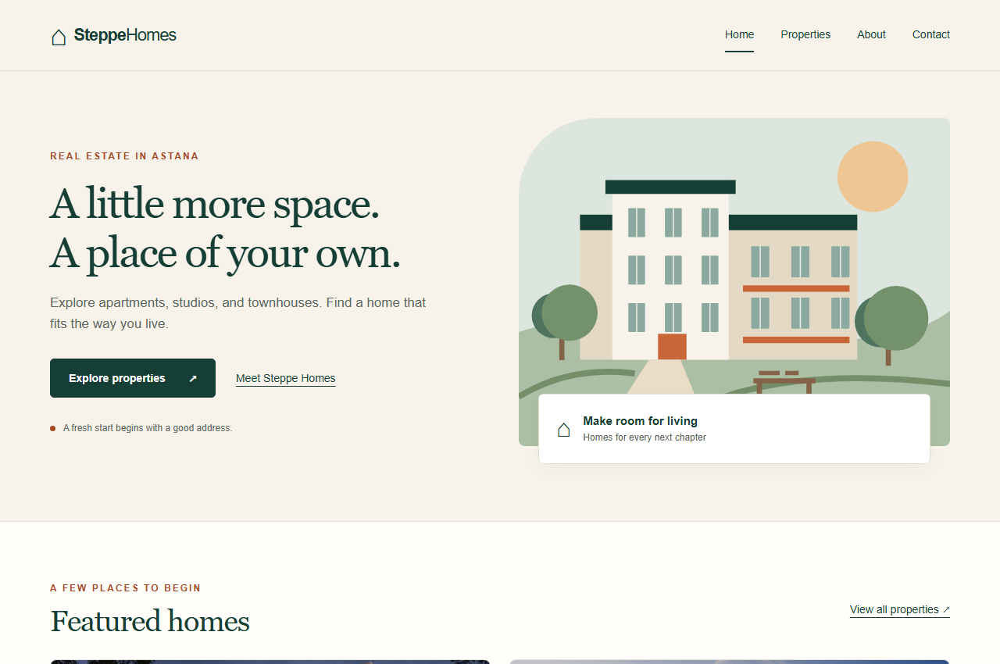

# Steppe Homes

A responsive real estate website for exploring sample properties in Astana. This university project uses HTML, CSS, Bootstrap, JavaScript, and jQuery.

The property collection features Nexpo Aura, W Towers, Дом на Ботаническом, and Dara Residence.



## Features

- Four connected pages with a shared design and navigation.
- Property listings with type and budget filter controls.
- A details popup with an image, description, specifications, and price.
- An enquiry link that selects the chosen property in the contact form.
- FAQ answers that open and close with a jQuery slide animation.
- Contact form validation with clear error messages.
- A responsive layout and a collapsible mobile menu.

## Pages

| Page | Purpose |
| --- | --- |
| Home | Introduces the website and shows featured properties. |
| Properties | Displays the listings, filters, and details popup. |
| About | Explains the project and includes the animated FAQ. |
| Contact | Provides an enquiry form with input validation. |

## Technologies

- HTML5 for the page structure.
- CSS3 for colors, spacing, typography, and responsive styles.
- Bootstrap 5.3.3 Grid for rows and columns.
- JavaScript for the page interactions and form checks.
- jQuery 3.7.1 for event handling and FAQ animation.

The libraries and images are included in the project. No installation or build step is required.

## Run locally

1. Download this repository using **Code → Download ZIP**.
2. Extract the ZIP and open the `SteppeHomes` folder.
3. Open `index.html` in a modern web browser.

Keep the `assets` folder alongside the HTML files.

## Project structure

```text
steppe-homes/
├── README.md
├── LICENSES.txt
├── docs/
│   └── screenshots/
└── SteppeHomes/
    ├── index.html
    ├── properties.html
    ├── about.html
    ├── contact.html
    └── assets/
        ├── style.css
        ├── script.js
        ├── vendor/
        └── property images
```

## Skills practiced

This project focuses on building responsive layouts, keeping a consistent design across several pages, updating page content with JavaScript and jQuery, and validating form input.

## Screenshots

[Properties page](docs/screenshots/properties.png) · [Mobile view](docs/screenshots/mobile.png)

## Demo content

The building names refer to real developments. The apartment details and prices are examples for this student project. This website is independent and is not affiliated with the featured developments.

The contact form checks input locally and displays a confirmation. It does not send or store messages.

## Possible improvements

- Keep each property's information in one place so the cards, filters, and form stay consistent.
- Add sorting by price and property size.
- Connect the contact form to a service that can deliver enquiries.

## Credits

Bootstrap and jQuery are used under the MIT License. Their notices are included in [LICENSES.txt](LICENSES.txt).

## Author

Temirgaliyev Nurassyl · [GitHub](https://github.com/barri857)
